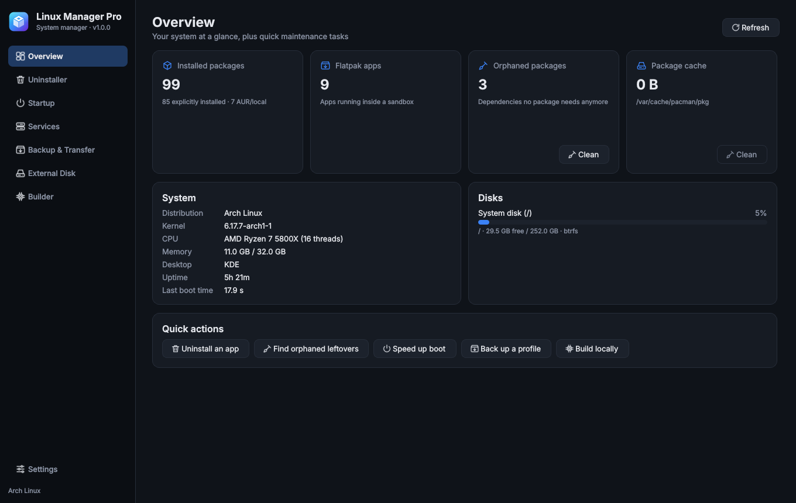
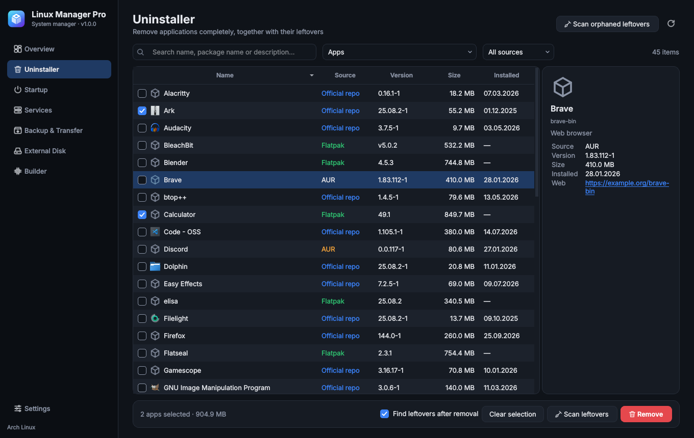
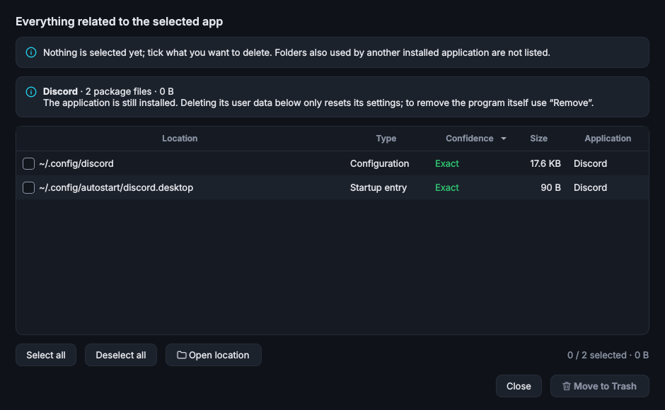
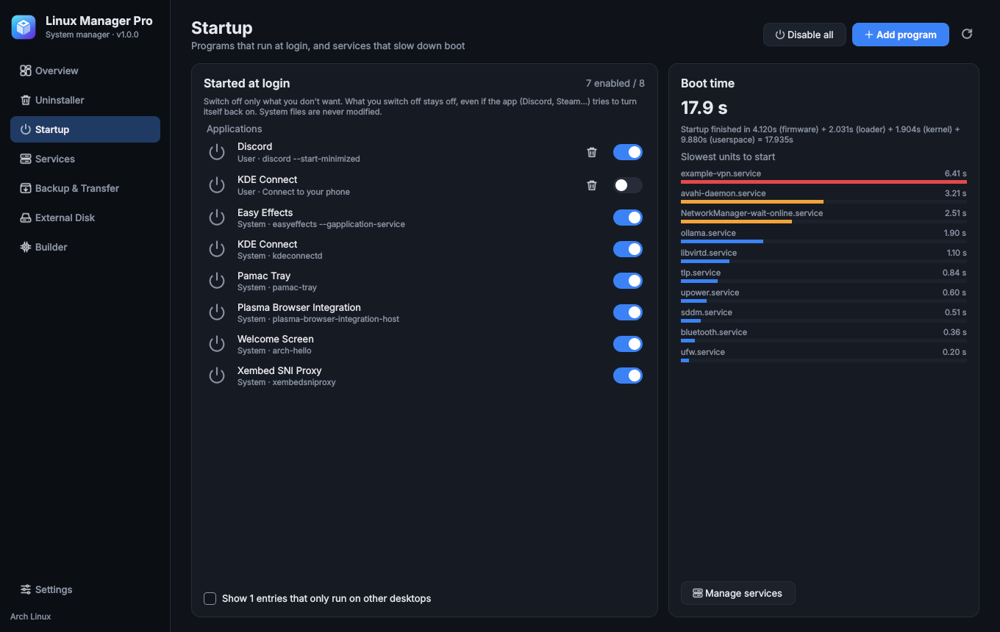
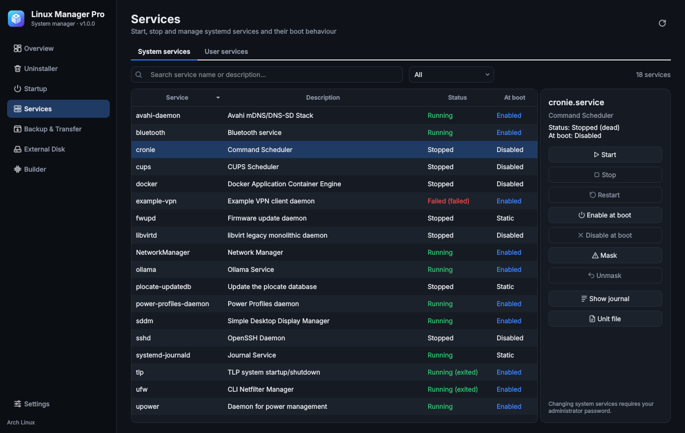

# Linux Manager Pro

**English** · [Türkçe](README.tr.md)

An all-in-one system manager for Arch Linux and its derivatives: the Linux answer to HiBit
Uninstaller, and more. Uninstall apps *completely*, tame startup and services, back up and
transfer your setup, install to an external disk, and build packages natively for your CPU.



## Supported distributions

Linux Manager Pro is built around **pacman**, so it runs on Arch Linux and distributions that
use pacman with systemd.

| Distribution | Status |
|---|---|
| Arch Linux | ✅ Supported (primary target) |
| CachyOS, EndeavourOS, Manjaro, Garuda, ArcoLinux, RebornOS | ✅ Supported (Arch-based, pacman + systemd) |
| Artix Linux and other systemd-free Arch derivatives | ⚠️ Partly: package features work, the Startup boot analysis and the Services page need systemd |
| Debian, Ubuntu, Linux Mint, Pop!_OS | ❌ Not yet (apt provider planned for v2.0) |
| Fedora, RHEL and derivatives | ❌ Not yet (dnf provider planned for v2.0) |
| openSUSE, Gentoo, NixOS, others | ❌ Not planned |

Requirements: Python 3.11+, PyQt6, polkit, systemd, util-linux, rsync. Optional: `flatpak`,
`pacman-contrib`, `base-devel` + `git`, `ccache`, `yay` or `paru`.

> **Status:** developed and unit-tested against a simulated pacman/Flatpak/systemd
> environment (see `tools/fake_env`). It has not had broad testing on real Arch machines yet.
> Back up important data before large operations, and please open an issue if something breaks.

## Features

| Page | What it does |
|---|---|
| **Overview** | System summary, disk usage, package counts; cleans orphaned packages and the pacman cache in one click |
| **Uninstaller** | Removes official-repo, AUR and Flatpak apps in bulk. Tick **Find leftovers after removal** and the disk is searched for the app's configuration, cache, data, icons, startup entries and services (graded Exact / Probable / Low). **Scan leftovers** lists everything related to an app *before* you remove anything: package files, services, dependencies and user data. Nothing is deleted until you review the list and confirm; leftovers go to the Trash. Also scans for orphaned folders left by apps removed earlier |
| **Startup** | Turns login programs on or off one by one, and they **stay off** even when an app such as Discord or Steam turns itself back on. Also lists your background user services and Hyprland/Sway/i3 start commands, adds new entries, **disables all apps with one click (and undoes it)**, shows which services slow down boot |
| **Services** | systemd system and user services: start, stop, enable at boot, mask, view journal and unit file |
| **Backup & Transfer** | Saves your app list (official + AUR + Flatpak) and chosen config folders into one `.tar.gz` profile. On a fresh install it shows what is missing, installs it all and restores settings (backing up existing ones first) |
| **External Disk** | Pick an app, press **Move to the external disk**: its program files and its data (game libraries, AI models such as Ollama's) move in one step and it keeps starting from the menu. The disk can be set to mount automatically, so moved apps also start after a reboot. Any large folder can be moved too. Everything is reversible |
| **Builder** | Gentoo-style: builds an official, AUR or git package with `-march=native`, O2/O3, LTO and ccache, installs it, and reminds you to rebuild when the repo ships a new version |
| **Settings** | Language, dark/light theme, deletion behaviour, AUR helper, build defaults |

| Uninstaller | Everything related to an app |
|---|---|
|  |  |
| **Startup** | **Services** |
|  |  |

## Language

The interface is available in **English** (default) and **Türkçe**. Change it in
**Settings → Language**; the window reloads immediately. Root-side messages and the pacman
hooks follow the same language. Adding a language means adding one file in `lmp/locales/`.

## Installation

```bash
git clone https://github.com/<your-user>/linux-manager-pro.git
cd linux-manager-pro
./install.sh
```

The script builds a pacman package (`linux-manager-pro`) from the project folder and installs
it. The app appears in the menu as **Linux Manager Pro**, or run `linux-manager-pro`. Run the
script again to update; remove with `sudo pacman -R linux-manager-pro`.

### Try it without installing

```bash
sudo pacman -S --needed python-pyqt6 polkit rsync
./run.sh
```

Everything works in this mode too.

## Security model

- The UI always runs as your normal user. Anything needing root goes through
  `pkexec /usr/lib/linux-manager-pro/lmp-helper <command>`; the helper accepts only defined
  commands and checks every path against an allow-list. The password is asked once for a few
  minutes.
- User leftovers go to the **Trash** by default. From system locations only paths owned by no
  package can be deleted.
- Package relocation does not use `IgnorePkg`, so updates keep working. While the disk is
  unplugged, a pacman hook stops only that package's update.
- When restoring a profile, settings that would be overwritten are first backed up to
  `~/.local/share/linux-manager-pro/backups/`.

## Project structure

```
lmp/core/     UI-independent logic (pacman, flatpak, systemd, leftovers, profile, relocation, builds)
lmp/helper.py Root helper (allow-listed commands)
lmp/i18n.py   Translation layer;  lmp/locales/  language catalogs
lmp/ui/       PyQt6 interface (pages, theme, task dialog)
lmp/data/     Config paths of known apps, logo
packaging/    PKGBUILD, .desktop, polkit policy, icons
tests/        Unit tests, one file per core module (pytest)
tools/        Fake pacman/Flatpak/systemd environment and the screenshot generator
docs/         PLAN.md (architecture and roadmap), screenshots
```

Run the tests with `python3 -m pytest tests`.

## License

[MIT](LICENSE)
