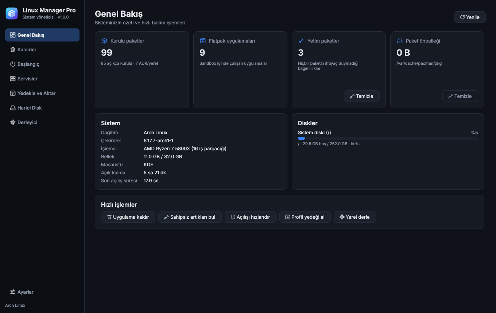
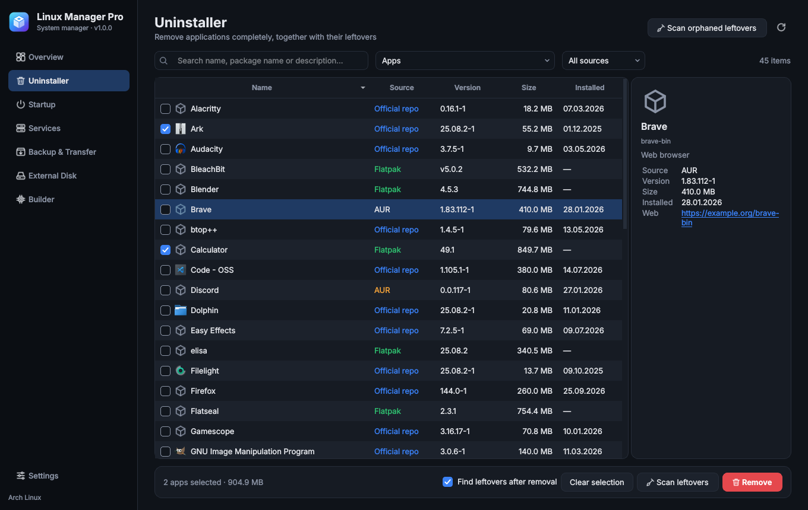
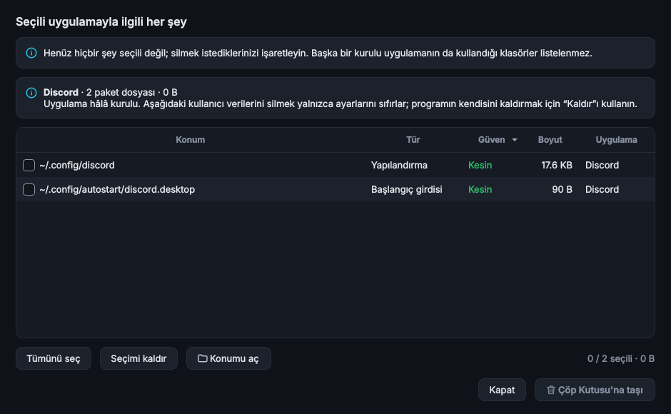
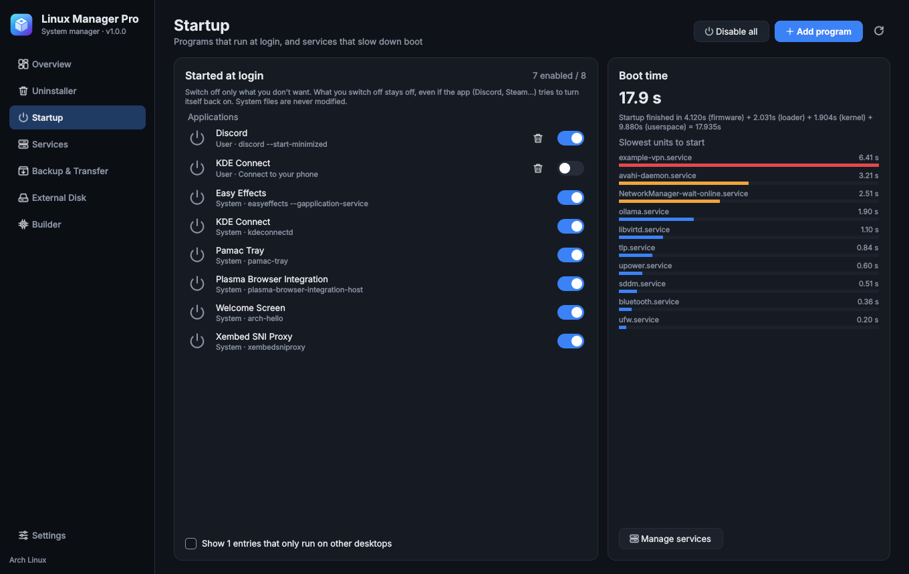
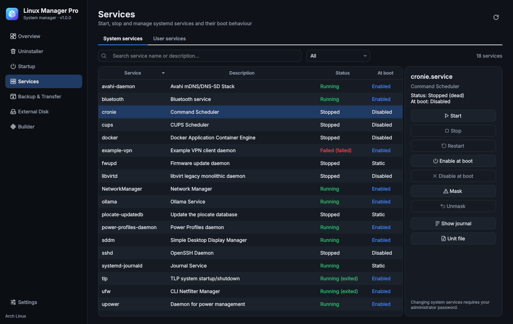

# Linux Manager Pro

[English](README.md) · **Türkçe**

Arch Linux ve türevleri için hepsi bir arada sistem yöneticisi: Windows'taki HiBit
Uninstaller'ın Linux karşılığı ve fazlası. Uygulamaları artıklarıyla *tamamen* kaldırın,
açılışı ve servisleri yönetin, kurulumunuzu yedekleyip taşıyın, harici diske kurun ve
paketleri işlemcinize özel derleyin.



## Desteklenen dağıtımlar

Linux Manager Pro **pacman** üzerine kuruludur; Arch Linux ve pacman + systemd kullanan
dağıtımlarda çalışır.

| Dağıtım | Durum |
|---|---|
| Arch Linux | ✅ Destekleniyor (birincil hedef) |
| CachyOS, EndeavourOS, Manjaro, Garuda, ArcoLinux, RebornOS | ✅ Destekleniyor (Arch tabanlı, pacman + systemd) |
| Artix Linux ve systemd kullanmayan diğer Arch türevleri | ⚠️ Kısmen: paket özellikleri çalışır, Başlangıç sayfasındaki açılış analizi ve Servisler sayfası systemd ister |
| Debian, Ubuntu, Linux Mint, Pop!_OS | ❌ Henüz yok (v2.0'da apt desteği planlı) |
| Fedora, RHEL ve türevleri | ❌ Henüz yok (v2.0'da dnf desteği planlı) |
| openSUSE, Gentoo, NixOS ve diğerleri | ❌ Planlanmıyor |

Gereksinimler: Python 3.11+, PyQt6, polkit, systemd, util-linux, rsync. İsteğe bağlı:
`flatpak`, `pacman-contrib`, `base-devel` + `git`, `ccache`, `yay` veya `paru`.

> **Durum:** Sahte bir pacman/Flatpak/systemd ortamında (`tools/fake_env`) geliştirildi ve
> birim testlerinden geçti. Gerçek Arch makinelerinde henüz geniş çaplı denenmedi. Büyük
> işlemlerden önce önemli verilerinizi yedekleyin; bir sorun çıkarsa lütfen issue açın.

## Özellikler

| Sayfa | Ne yapar |
|---|---|
| **Genel Bakış** | Sistem özeti, disk doluluğu, paket sayıları; yetim paketleri ve pacman önbelleğini tek tıkla temizler |
| **Kaldırıcı** | Resmi depo, AUR ve Flatpak uygulamalarını toplu kaldırır. **Kaldırınca kalıntıları tara** kutusunu işaretlerseniz uygulamanın ayarları, önbelleği, verileri, simgeleri, başlangıç girdileri ve servisleri için disk taranır (Kesin / Muhtemel / Düşük olarak derecelendirilir). **Kalıntıları tara** düğmesi, hiçbir şeyi kaldırmadan önce uygulamayla ilgili her şeyi listeler: paket dosyaları, servisler, bağımlılıklar ve kullanıcı verileri. Listeyi gözden geçirip onaylamadan hiçbir şey silinmez; kalıntılar Çöp Kutusu'na gider. Daha önce kaldırılmış uygulamalardan kalan sahipsiz klasörleri de tarar |
| **Başlangıç** | Oturum açılışında başlayan programları tek tek açar/kapatır; Discord, Steam gibi kendini tekrar açan uygulamalar bile **kapalı kalır**. Kullanıcı servislerini ve Hyprland/Sway/i3 başlangıç komutlarını da listeler, yeni girdi ekler, **tüm uygulamaları tek tıkla kapatır (ve geri alır)**, açılışı yavaşlatan servisleri gösterir |
| **Servisler** | systemd sistem ve kullanıcı servisleri: başlat, durdur, açılışta etkinleştir, maskele, günlüğü ve birim dosyasını gör |
| **Yedekle ve Aktar** | Uygulama listenizi (resmi + AUR + Flatpak) ve seçtiğiniz ayar klasörlerini tek bir `.tar.gz` profile kaydeder. Yeni kurulumda eksikleri gösterir, hepsini kurar ve ayarları (mevcutları yedekleyerek) geri yükler |
| **Harici Disk** | Uygulamayı seç, **Harici diske taşı**'ya bas: program dosyaları ve verileri (oyun kütüphaneleri, Ollama gibi yapay zekâ modelleri) tek adımda taşınır, uygulama menüden açılmaya devam eder. Disk otomatik bağlanacak şekilde ayarlanabilir; böylece taşınan uygulamalar yeniden başlattıktan sonra da açılır. İstenen büyük klasör de taşınabilir. Hepsi geri alınabilir |
| **Derleyici** | Gentoo tarzı: resmi, AUR ya da git paketini `-march=native`, O2/O3, LTO ve ccache ile derleyip kurar; depoda yeni sürüm çıkınca yeniden derlemenizi hatırlatır |
| **Ayarlar** | Dil, koyu/açık tema, silme davranışı, AUR yardımcısı, derleme varsayılanları |

| Kaldırıcı | Bir uygulamayla ilgili her şey |
|---|---|
|  |  |
| **Başlangıç** | **Servisler** |
|  |  |

(Ekran görüntüleri İngilizce arayüzdendir; Kalıntılar penceresi Türkçedir.)

## Dil

Arayüz **İngilizce** (varsayılan) ve **Türkçe** olarak kullanılabilir. **Ayarlar → Dil**
bölümünden değiştirin; pencere hemen yenilenir. Kök yetkili yardımcının mesajları ve pacman
kancaları da aynı dili kullanır. Yeni dil eklemek için `lmp/locales/` altına bir dosya
eklemek yeterlidir.

## Kurulum

```bash
git clone https://github.com/<kullanici-adiniz>/linux-manager-pro.git
cd linux-manager-pro
./install.sh
```

Betik proje klasöründen bir pacman paketi (`linux-manager-pro`) oluşturup kurar. Uygulama
menüde **Linux Manager Pro** olarak görünür, ya da `linux-manager-pro` komutuyla açılır.
Güncellemek için betiği yeniden çalıştırın; kaldırmak için `sudo pacman -R linux-manager-pro`.

### Kurmadan denemek

```bash
sudo pacman -S --needed python-pyqt6 polkit rsync
./run.sh
```

Bu modda da her şey çalışır.

## Güvenlik modeli

- Arayüz her zaman normal kullanıcı olarak çalışır. Yönetici yetkisi gereken her işlem
  `pkexec /usr/lib/linux-manager-pro/lmp-helper <komut>` üzerinden gider; yardımcı yalnızca
  tanımlı komutları kabul eder ve her yolu beyaz listeyle doğrular. Parola birkaç dakika
  boyunca bir kez sorulur.
- Kullanıcı artıkları varsayılan olarak **Çöp Kutusu'na** gider. Sistem konumlarından yalnızca
  hiçbir paketin sahip olmadığı yollar silinebilir.
- Paket taşıma `IgnorePkg` kullanmaz; güncellemeler sürer. Disk takılı değilken yalnızca o
  paketin güncellemesi bir pacman kancasıyla durdurulur.
- Profil geri yüklerken üzerine yazılacak ayarlar önce
  `~/.local/share/linux-manager-pro/backups/` altına yedeklenir.

## Proje yapısı

```
lmp/core/     Arayüzden bağımsız iş mantığı (pacman, flatpak, systemd, artıklar, profil, taşıma, derleme)
lmp/helper.py Kök yetkili yardımcı (beyaz listeli komutlar)
lmp/i18n.py   Çeviri katmanı;  lmp/locales/  dil katalogları
lmp/ui/       PyQt6 arayüz (sayfalar, tema, görev penceresi)
lmp/data/     Bilinen uygulamaların ayar yolları, logo
packaging/    PKGBUILD, .desktop, polkit kuralı, simgeler
tests/        Birim testleri, çekirdek modül başına bir dosya (pytest)
tools/        Sahte pacman/Flatpak/systemd ortamı ve ekran görüntüsü üreteci
docs/         PLAN.md (mimari ve yol haritası, İngilizce), ekran görüntüleri
```

Testler: `python3 -m pytest tests`

## Lisans

[MIT](LICENSE)
